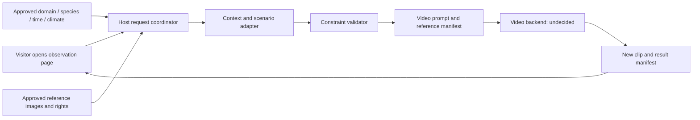

# Draft architecture, not implemented

Stage II hypothesis: evaluate context interpretation and scenario/prompt construction in C on UGen300 / Hailo-10H using a supported model. H and V run on the host unless later evidence supports a different split. G remains unselected and unvalidated. Confirm split eligibility with the organizer. No deployed component exists today.

## Proposed interface behavior
1. `POST /v1/observations`: validate a domain/context/reference request, create request id, return queued status. Every opening intends a fresh generation request. Idempotency retries of the same opening must not double-charge.
2. Internal `ScenarioAdapter.compose(request, domain)`: return a candidate scenario, eligible species and bounded motion prompt.
3. `VideoAdapter.submit(prompt, reference_ids)`: return job id. Provider, resolution, duration, cost and licensing remain undecided.
4. `GET /v1/observations/{id}`: return queued, preparing, generating, ready or failed with honest provenance and optional clip location.
5. A ready result must distinguish `generated_new` from `preexisting_concept`. Errors must not silently replace new generation with an old clip. The sample result is `not_executed`, has no URL and has no timing measurements.

## Data and privacy
Domain and reference records need creator authorization and provenance. Default context is fictional and creator-defined. A live-weather extension would need explicit location choice, timestamp and source. Do not collect precise visitor location by default. Retain request ids and technical timings only as needed. Keep provider credentials on the server and outside the repo.

## Failure and quality checks to implement
Reject unknown species, missing reference approvals and unsupported context values. Validate prompt schema before spending a generation credit. Record provider failures and timeout states. Flag visual artifacts during evaluation. Ensure clip labels remain visible. Validate actual device usage and do not use host-only execution as hardware evidence.
