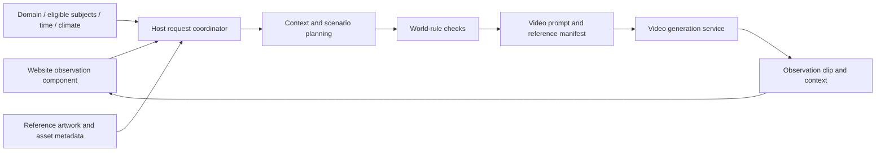

# Observation architecture and interface plan

Team: **FlyPig AI**. Project: OnDemand World Observatory. Author: M.K. Hsu.

The planned architecture connects an embeddable website observation component with world data, scenario planning and a video generation service.

## Planned division of work

- **Website component:** accepts a scene identifier and observation conditions, presents request status, and plays the clip with a contextual description.
- **Host coordinator:** manages domain data and references, checks world rules and tracks generation jobs.
- **ASUS UGen300 / Hailo-10H:** a candidate for context interpretation and scenario/prompt planning with a supported model. Development would evaluate model support and host/runtime compatibility.
- **Video generation service:** creates short clips from the planned prompt and reference images. Provider selection and integration would follow cost, rights and deployment evaluation.

The Stage II evaluation would confirm this division of work against the track requirements and record device inference separately from video-service processing.

## Proposed interfaces

1. `POST /v1/observations`: accepts domain, context and reference identifiers, creates a request id and returns generation status. Idempotency would associate retries with the same opening.
2. `ScenarioAdapter.compose(request, domain)`: plans an eligible subject, activity, environment and viewing perspective within world rules.
3. `VideoAdapter.submit(prompt, reference_ids)`: submits the reference-conditioned prompt and returns a job id.
4. `GET /v1/observations/{id}`: returns queued, preparing, generating, ready or failed status, with clip and context metadata when available.

## Context and visual consistency

Domain records would define subject eligibility, time/climate options and permitted activities. Reference records would provide visual identity and asset approvals. The coordinator would check the candidate scenario before generation and retain the prompt, references and result metadata for evaluation.

The examples in `examples/` illustrate the planned payloads. Their `not_executed` status and null result fields identify them as written design samples. A future output would include explicit provenance for a generated clip or a labeled reference preview.

## Data and operation

Initial context would come from creator-defined settings. A later live-weather extension would include an operator-selected location, source and timestamp. Credentials would remain on the host service. Request logs would support status reporting, troubleshooting and evaluation with limited retention.

Quality checks would cover subject eligibility, reference consistency, visual artifacts, failed jobs and playback status. Performance evaluation would measure context preparation, device prompt planning, video generation and total time to playback separately.
